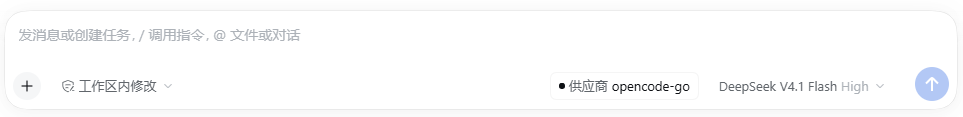

# dsh-model-provider-badge

[English](README.md) | 中文

在 DSH Web 输入框的工具行里，紧挨着模型选择器左侧显示**当前会话所用模型的供应商**。



```
[+] [工作区内修改]              [● 供应商 opencode-go] [DeepSeek V4.1 Flash High ⌄] [↑]
                                  ^^^^^^^^^^^^^^^^^^ 本插件新增
```

## 它显示什么

- 供应商名称取自 Host 模型目录里该模型所属的分组名（`ModelProviderGroup.name`），
  因此与 `/model` 弹窗、模型选择器里的分组标题**完全一致**。
- 数据源是与模型选择器**同一个** per-session 目录（client 服务 `modelDirectories`），
  所以未选过模型的新会话会显示部署默认模型的供应商，切换模型后立即跟着变。
- 供应商已从目录移除时退回上一次广告到的失败名，最后退回供应商 id 本身。

## 安装

```sh
dsh plugin --profile web add github:huihuangdi/dsh-model-provider-badge
```

也可以用本地目录安装：

```sh
dsh plugin --profile web add /path/to/dsh-model-provider-badge
```

无需构建：纯 JavaScript，没有 install / 生命周期脚本，不涉及 `allowBuilds` 授权。
装完**整页刷新**一次——客户端半边由 Web 外壳加载，不由 Host 加载。

## 位置与实现

- 座位：`conversation.input.right`（`@deepseek-ai/dsh-client-ui-conversation` 声明）。
  该座位在 DOM 中渲染于模型选择器之前 —— 也就是模型名左边的空位。
- `index.js` 是 Host 半边：一个普通插件行，外加一个只在 profile 有 Web server 时注册的
  只写诊断路由。
- `client.js` 是浏览器半边，通过 `window.__ModuleLoader__` 加载，用
  `ctx.slots.inject(...)` + `ctx.slots.register(...)` 占住座位。
- 样式只用主题 token（`--dsw-alias-*`、`--dsw-radius-sm`），尺寸照抄宿主模型座位触发器
  （28px 高、13px/400 字号、4px 间距），因此和同一行的控件是一套视觉。
- 文案走 client locale（命名空间 `model-provider-badge`，内置 zh / en）。

## ⚠️ 踩过的坑（写 DSH 客户端插件的人建议先读）

**1. 读别人的 Service 必须先声明，否则整个 GUI 起不来。**
本运行时的规则是：插件只能通过自己的 `inject` 列表或 `ctx.inject([...], …)`
拿到**别的插件**注册的服务。直接读 `ctx.locale` / `ctx.slots` 这类未声明的服务会抛
`cannot get property "<name>" without inject`；`apply` 里逃出去的异常会判定为该客户端插件
激活失败，Web 外壳直接显示 **“Failed to load plugins” 并且整个界面不再启动**
（不是只少一个徽标）。第一版就栽在这里：声明了 `slots` 却直接用了 `ctx.locale`。
**结论：`inject` 列表里必须有 `['slots', 'locale']`**；可选的 `modelDirectories`
走 `ctx.inject([...], …)`（缺服务时插件保持 inactive，而不是 failed）。

**2. 装饰性插件不要让它有能力拖垮 GUI。**
`apply` 整个包在 `try/catch` 里，失败只 `console.error`，绝不向上抛。

**3. 渲染器的「注入面」是按 (entry × session binding) 缓存一辈子的。**
`@deepseek-ai/dsh-client-ui-renderer` 的 `cachedRootInject` / `cachedSessionInject` 只算一次并长期缓存。
所以**注入面里绝不能放任何可能失败或派生的值**。
已确认的触发链条（2026-10-14 实测）：

1. `dsh-api-session-controller` 的 `binding(id)` 是「借用」语义：`return this.scopes.get(id)?.binding`——
   会话 scope 还没 retained 时返回 `undefined`（它不会顺手创建）。
2. `models.directoryFor(sessionId)` 因此会抛 `... resolved no binding`。
3. 第一版把它包在 `try/catch` 里返回 `{}`，而渲染器把这个 `{}` **按 entry 缓存到整页生命周期**。

结果就是最难查的那种失败：座位注册着、`active: true`、控制台不报错、页面功能正常，**徽标永远不显示**。
（模型座位不受影响，是因为它是另一个 entry、另一份缓存，且它不吞异常。）
**结论：注入面只放「服务 + 本 binding 的 sessionId」这类永远拿得到的东西，store 放到组件里每次
render 现解析**（`resolveDirectory()`），失败不缓存，并在 binding 还没建好时做有限次重试（10 × 300ms）。

**4. 尺寸和配色要抄宿主控件，不要自己发明。**
第一版徽标用 24px 高 / 12px 字，还在已变暗的 token 上又叠了 `opacity:.75`，结果：
① 比旁边的模型座位明显小一号；② 中文「供应商」在一堆淡化参数下看着像**没渲染完整**（用户反馈
“框体是否太小？有些字母没有显示完整”）。
宿主的模型座位触发器实测是 `height:28px; font-size:13px; font-weight:400; line-height:20px;
gap:4px; color:var(--dsw-alias-label-secondary)`，照抄即可。**结论：字号/高度/间距抄宿主控件；
不要叠加 opacity 去“弱化”已经弱化的 token；`flex:0 0 auto` + `white-space:nowrap` 保证文字不被挤，
只给最长的那个子元素（供应商名）留 ellipsis。**

**5. 静默失败必须留证据（异常埋点）。**
Host 半边注册了一个只写的诊断路由 `POST /model-provider-badge/report`，把浏览器半边的异常
追加到 `/tmp/model-provider-badge.log`（正常页面只写一行 `render-ok`）。这样“徽标没出现”
永远能区分成：模块没执行 / apply 抛错 / 目录解析不了 / 目录没有 current / 渲染本身出错 /
渲染成功但被布局挤掉。排查这类“看不见的失败”先看这个文件。

**6. 回归自检（改完必跑）：**

```bash
node test/activation.selftest.mjs
```

它用真实的 `@deepseek-ai/cordis` 复刻浏览器里的服务拓扑（服务由**兄弟插件**提供，
而不是挂在 root 上），断言：`inject` 覆盖了用到的服务、apply 没抛异常、词典注册成功、
`conversation.input.right` 座位注册成功、注入面只带服务与 binding sessionId（可被缓存而不会
被污染）。把 `inject` 改回 `['slots']` 会立刻报 10 条 FAIL —— 这就是那次事故的复现。

> 该自检需要本机 DSH 安装路径；非默认路径时用 `DSH_INSTALL=<dsh 安装目录>` 覆盖。

## 许可

MIT，见 [LICENSE](LICENSE)。
